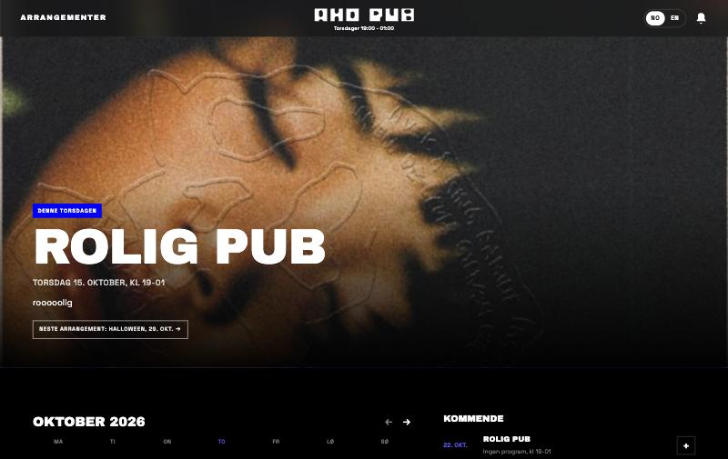
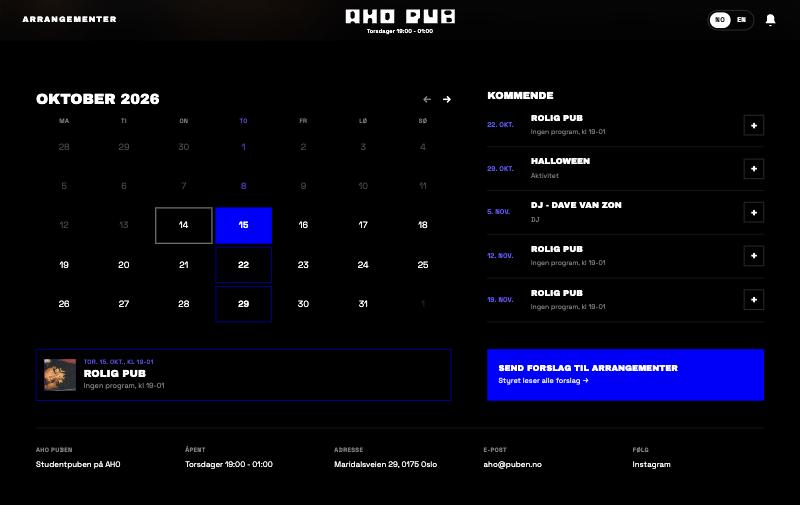
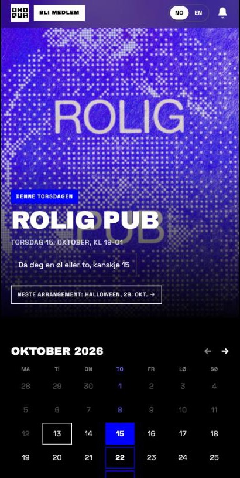
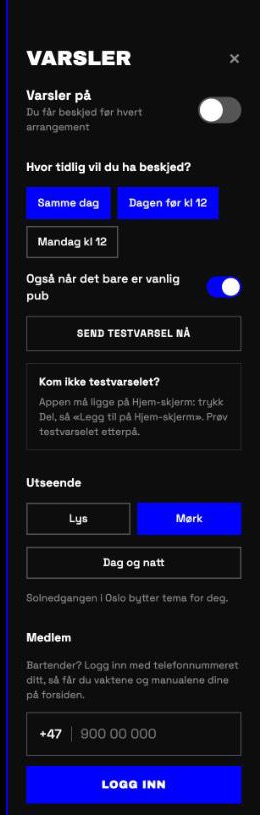
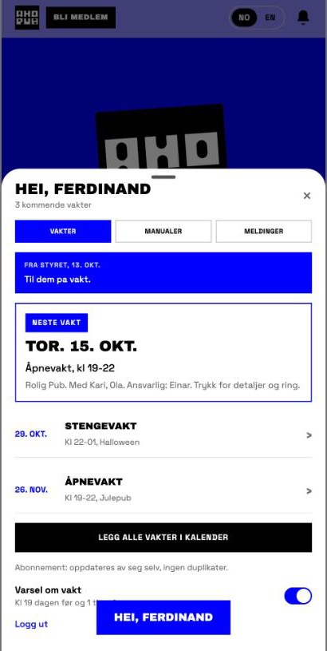
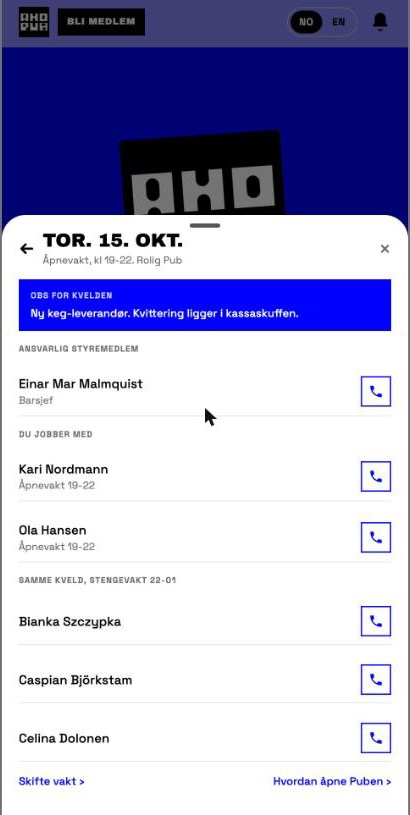
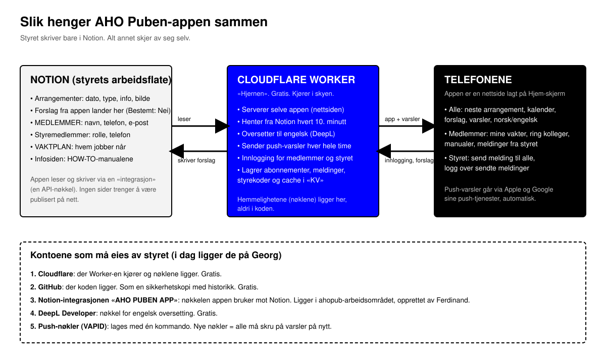

# AHO Puben-appen: overlevering til styret

Skrevet 14. oktober 2026 av Georg Ferdinand Nilsen (med hjelp av Claude), sist oppdatert samme kveld med PC-versjonen. Denne pakken inneholder alt som trengs for å forstå, drifte og flytte appen til styrets egne kontoer. Les dette dokumentet først. Det er skrevet for folk som ikke har bygget nettsider før.

Appen er også pubens nettside: den er laget for både telefon og PC, og skal ligge rett på ahopuben.no.

Adressen til appen i dag: https://aho-puben.georgferdinandnilsen.workers.dev

---

## 1. Hva appen er

AHO Puben-appen er en nettside som folk legger på Hjem-skjermen på telefonen. Den viser hva som skjer på puben, og sender push-varsler før hvert arrangement. Styret trenger aldri å røre koden: alt innhold skrives i Notion, og appen henter det derfra.

Den har tre lag:

- **For alle:** neste arrangement øverst, en kalender, forslagsskjema til styret, varsler man styrer selv, norsk og engelsk, lyst og mørkt tema.
- **For medlemmer (bartendere):** logg inn med telefonnummer og få egne vakter, kolleger man kan ringe med ett trykk, manualene fra Notion, kalenderabonnement og varsel før vakt.
- **For styret:** send melding til alle medlemmer eller dem på vakt, se hvor mange som har lest, og en logg over alt som er sendt. Pluss en bryter som skjuler «Bli medlem»-knappen for alle når opptaket er stengt, og tall på hvor mange som har varsler på og har lagt appen på Hjem-skjerm.

**På PC** er appen en vanlig nettside med samme innhold: topplinje med logo og åpningstider, plakaten i full bredde, kalender til venstre, kommende arrangementer og forslag til høyre, og tider, adresse, e-post og Instagram i bunnen. Det er samme fil og samme kode, bare bredere, så det finnes ingen egen PC-versjon å vedlikeholde. Fra 900 piksler bredde bytter den om av seg selv.





 

 

 

 

---

## 2. Slik henger det sammen



Tre deler snakker sammen:

1. **Notion** er der styret jobber. Databasene Arrangementer, MEDLEMMER, Styremedlemmer og VAKTPLAN, pluss infosiden med manualene. Appen leser dem gjennom en «integrasjon», som er en nøkkel Notion deler ut. Ingen Notion-sider trenger å være publisert på nett.
2. **Cloudflare Worker** er hjernen. Et lite program som kjører gratis i skyen. Det serverer selve nettsiden, henter fra Notion hvert 10. minutt, oversetter til engelsk, sender push-varsler hver hele time, håndterer innlogging og lagrer småting (abonnementer, meldinger, styrekoder) i et lager som heter KV. Alle nøkler ligger her, aldri i koden.
3. **Telefonene** viser appen. Push-varslene går gjennom Apple og Google sine tjenester, helt automatisk.

I tillegg ligger **koden på GitHub** som sikkerhetskopi med historikk, og **designet i Figma**.

---

## 3. Hvem eier hva i dag

| Hva | Hvor | Eies av | Hva det brukes til |
|---|---|---|---|
| Cloudflare-konto | dash.cloudflare.com | Georg (georgferdinandnilsen@gmail.com) | Kjører Worker-en «aho-puben», lagret KV, alle hemmeligheter |
| Adressen | aho-puben.georgferdinandnilsen.workers.dev | Følger Cloudflare-kontoen | Det folk har lagt på Hjem-skjerm. Blir ahopuben.no etter flyttingen |
| Domenet ahopuben.no | Der domenet er registrert | Puben | Peker i dag på en Google Sites-side. Skal peke på appen |
| GitHub-repo | github.com/georgferdinandnilsen/AHOPUBEN | Georg | Koden, med historikk |
| Notion-integrasjon «AHO PUBEN APP» | notion.so/profile/integrations | Opprettet av Ferdinand i AHO PUB-arbeidsområdet | Nøkkelen appen bruker mot Notion |
| DeepL Developer | deepl.com | Georg | Engelsk oversetting, gratis |
| Push-nøkler (VAPID) | Lagret i Cloudflare | Laget av Georg | Gjør at akkurat denne appen får sende push |
| Figma-fil «FERDINAND» | figma.com | Georg | Designet, tre utkast og den valgte versjonen |

**Hva skjer når Georg slutter?** Alt fortsetter å virke så lenge kontoene hans finnes. Men ingen i styret kan rette feil, bytte nøkler eller endre noe. Derfor må appen flyttes, eller styret må få tilgang. Begge veier står under.

---

## 4. Overføring til styret

Først ett råd: **lag en felles styre-e-post** (for eksempel en Gmail som heter noe med ahopuben) og en passordhåndterer styret deler. Opprett alle kontoene under på den e-posten, ikke på en privat. Da overlever de neste styreskifte.

Appen skal settes opp på nytt på styrets egne kontoer, og legges på pubens eget domene **ahopuben.no**. Det høres mye ut, men det er en kveld med en PC og denne listen. Alt er gratis. Gjør punktene i rekkefølge, og kryss av i SJEKKLISTE.md underveis.

**Steg 0. Forberedelser**
- En Mac eller PC. Alt under gjøres i programmet Terminal (Mac) eller PowerShell (Windows).
- Styre-e-posten og passordhåndtereren fra rådet over.
- Tilgang til der ahopuben.no er registrert (for eksempel Domeneshop eller One.com). Dere trenger å logge inn der i steg 9.
- Hent mappen `app` fra denne pakken, eller last ned koden fra GitHub (grønn «Code»-knapp → Download ZIP). Legg mappen et sted med en enkel sti, for eksempel `Dokumenter/aho-puben`. Ikke bruk mellomrom i mappenavnet.

**Steg 1. Installer Node.js**
- Gå til nodejs.org og installer «LTS»-versjonen. Det er programmet som kjører verktøyene.
- Åpne Terminal, gå til mappen og installer avhengighetene:

```
cd Dokumenter/aho-puben
npm install
```

**Steg 2. Lag Notion-integrasjonen (nøkkelen mot Notion)**
- Gå til notion.so/profile/integrations, logget inn som en som er administrator i arbeidsområdet AHO PUB.
- Trykk «Ny forbindelse». Navn: AHO PUBEN APP. Arbeidsområde: AHO PUB. Type: intern.
- Under Capabilities/Funksjoner: huk av Les innhold, Oppdater innhold, Sett inn innhold, og velg «Les brukerinformasjon uten e-postadresser». Uten den siste vises styremedlemmer som rollen sin i stedet for navn.
- Kopier «Internal Integration Secret». Det er nøkkelen. Lim den aldri i en chat eller e-post. Legg den i passordhåndtereren.
- Koble integrasjonen til sidene. Åpne hver av disse i Notion, trykk `…` øverst til høyre → Tilkoblinger → velg AHO PUBEN APP:
  - Arrangementer (siden som inneholder databasen)
  - MEDLEMMER
  - Styremedlemmer
  - VAKTPLAN
  - AHO PUB - INFOSIDE MEDLEMMER
- Alternativ: gjør det fra integrasjonens egen side under fanen «Tilgang».

**Steg 3. Lag DeepL-nøkkel (engelsk oversetting)**
- Gå til deepl.com/pro-api og velg planen Developer (gratis, engangskreditt på 1 million tegn, holder i mange år).
- Finn API-nøkkelen under kontoen din. Legg den i passordhåndtereren.

**Steg 4. Lag Cloudflare-konto og logg inn fra Terminal**
- Opprett konto på dash.cloudflare.com med styre-e-posten. Gratisplanen holder.
- I Terminal, i app-mappen:

```
npx wrangler login
```

- En nettleser åpner seg. Trykk Allow.

**Steg 5. Lag lageret (KV)**

```
npx wrangler kv namespace create KV
```

- Terminalen skriver ut en linje med `id = "…"`. Åpne filen `wrangler.toml` i et tekstprogram og bytt ut id-en under `[[kv_namespaces]]` med den nye.

**Steg 6. Lag push-nøkler**

```
npm run vapid
```

- Du får en «Public Key» og en «Private Key». Begge skal inn som hemmeligheter i neste steg. Den private deles aldri.

**Steg 7. Legg inn hemmelighetene**

Hver kommando spør «Enter a secret value». Lim inn verdien og trykk Enter. Verdien vises ikke.

```
npx wrangler secret put NOTION_TOKEN
npx wrangler secret put NOTION_DB_ID
npx wrangler secret put NOTION_SUGGEST_DB_ID
npx wrangler secret put DEEPL_KEY
npx wrangler secret put VAPID_PUBLIC
npx wrangler secret put VAPID_PRIVATE
```

| Hemmelighet | Hva du limer inn |
|---|---|
| NOTION_TOKEN | Nøkkelen fra steg 2 |
| NOTION_DB_ID | Id-en til Arrangementer-databasen: `306fc4bc274d803fbcaac5b17542df12` |
| NOTION_SUGGEST_DB_ID | Samme id: `306fc4bc274d803fbcaac5b17542df12` (forslag lagres i samme database) |
| DEEPL_KEY | Nøkkelen fra steg 3 |
| VAPID_PUBLIC | Public key fra steg 6 |
| VAPID_PRIVATE | Private key fra steg 6 |

Database-id er de 32 tegnene i lenken til databasen i Notion. Id-ene til medlemsdatabasene står i `wrangler.toml` under `[vars]` og trenger ikke endres så lenge dere bruker de samme databasene. Lager dere nye databaser, finner dere datakilde-id slik: åpne databasen → `…` → Administrer datakilder → `…` ved kilden → Kopier datakilde-ID.

**Steg 8. Publiser første gang**

```
npm run deploy
```

- Terminalen skriver ut en midlertidig adresse, for eksempel `https://aho-puben.<kontonavn>.workers.dev`. Bruk den til å teste i steg 10. Den endelige adressen kommer i steg 9.
- Åpne adressen på en telefon. Ser du de ekte arrangementene fra Notion, virker Notion-koblingen. Ser du «Halloween, DJ: Dave Van Zon, Julepub» med eksempeltekst, mangler NOTION_TOKEN eller koblingen til sidene.

**Steg 9. Legg appen på ahopuben.no**

Bestemt 14. oktober 2026: appen skal være selve forsiden på **ahopuben.no** og erstatte dagens Google Sites-side. Alt som står der i dag (åpningstider, adresse, e-post og Instagram) ligger allerede i bunnen av appen. Adressen kan ikke byttes senere uten at alle må legge appen til på nytt, så gjør dette før dere deler den.

1. I Cloudflare: trykk «Add a domain» (Onboard a domain), skriv `ahopuben.no`, velg gratisplanen. Cloudflare leser inn dagens DNS-oppføringer. Sjekk at det som skal beholdes står der (e-posten aho@puben.no ligger på et annet domene og berøres ikke).
2. Cloudflare gir dere to navnetjenere (nameservers), for eksempel `anna.ns.cloudflare.com` og `bob.ns.cloudflare.com`. Logg inn der domenet er registrert, finn «Navnetjenere»/«DNS-servere» for ahopuben.no, og bytt til de to. Det tar fra noen minutter til et døgn før det slår inn. Cloudflare sender e-post når det er klart.
3. I Cloudflare: Workers & Pages → aho-puben → Settings → Domains & Routes → Add → Custom Domain → skriv `ahopuben.no` → Add. Gjør det samme en gang til med `www.ahopuben.no`, for dagens side bruker www. Cloudflare ordner sertifikat og DNS selv. Finnes det gamle DNS-oppføringer for ahopuben.no eller www som peker til Google Sites, ber Cloudflare dere fjerne dem.
4. I Google Sites: åpne siden → Innstillinger → Egendefinerte domener, og fjern ahopuben.no, så den gamle siden ikke konkurrerer. Siden kan bli liggende upublisert som backup.
5. Åpne https://ahopuben.no på telefon og på PC. Det er den endelige adressen. Den gamle workers.dev-adressen virker fortsatt, men del bare den nye.

**Steg 10. Test**
- Trykk bjella, logg inn med ditt eget nummer. Står du i MEDLEMMER eller Styremedlemmer med nummeret, kommer du inn.
- Slå på varsler og trykk «Send testvarsel nå». Kommer det ikke: appen må ligge på Hjem-skjerm.
- Som styremedlem: «Send melding», velg en styrekode, send en testmelding til deg selv.

**Steg 11. Bytt over**
- Send den nye adressen til alle. Alle må legge appen på Hjem-skjerm på nytt og slå på varsler på nytt. Det gamle ikonet kan slettes.
- Styremedlemmer velger styrekode på nytt.
- GitHub: lag en konto på styre-e-posten og be Georg overføre repoet (Settings → Transfer ownership), eller last opp mappen `app` som et nytt repo. Repoet er sikkerhetskopien med historikk.
- Når alt virker, tar Georg ned den gamle: i hans mappe kjører han `npx wrangler delete`, og sletter sin Notion-integrasjon.

**Dette blir ikke med over automatisk** (det ligger i det gamle KV-lageret): hvem som har varsler på, styrekoder, meldingsloggen og «sett»-tellinger. Det er greit å starte på null.

**Hvis dere heller vil overta Georgs kontoer** i en overgangsperiode: han kan invitere styre-e-posten som Super Administrator i Cloudflare (Manage Account → Members), legge til et styremedlem under «Eiere av tilkoblinger» på Notion-integrasjonen, og gi tilgang til GitHub-repoet. Det er raskt, men alt heter fortsatt Georg, så gjør den ordentlige flyttingen over når dere har en kveld.

---

## 5. Drift i hverdagen: det styret gjør i Notion

Appen følger disse reglene. Ingen kode trengs.

**Arrangementer**
- Et arrangement vises i appen når det har en dato i feltet **Når** som er i dag eller senere. Ingen dato, ingen visning.
- **Type arrangement** blir etiketten (Aktivitet, DJ og så videre). Typen «Rolig Pub» betyr vanlig pub uten program.
- **Info til APP** er teksten som vises under datoen. Oversettes automatisk til engelsk.
- **Bilde til APP** blir bildet øverst. Uten bilde vises et fast bilde av puben (filen `public/fallback.jpg`). Vil dere bytte det, bytt filen og kjør `npm run deploy`.
- Endringer vises i appen innen ti minutter.
- Torsdager uten rad i Notion vises automatisk som «Rolig pub, kl 19-01».

**Forslag fra folk**
- Forslag fra appen lander som ny rad i Arrangementer med **Bestemt** satt til Nei, og teksten inne på siden. De vises i visningen Ideer. Sett en dato i Når når et forslag blir et arrangement.

**MEDLEMMER**
- Appen bruker **Full name**, **Phone**, **E-mail** og datoen i **How long do you want to be a member?**. Er datoen passert, får personen ikke logge inn.
- Telefonnummeret må ha landskode hvis det ikke er norsk, for eksempel +46 70 123 45 67. Mellomrom spiller ingen rolle.
- Får et medlem «Fant ikke nummeret» tre ganger, kan de rette nummeret selv via e-posten sin. Appen skriver da det nye nummeret inn i Phone-feltet.

**Styremedlemmer**
- Nummeret i **Telefon** gir styrerettigheter i appen. Det må være det samme nummeret personen logger inn med.
- **Person**-feltet må være satt til personens Notion-bruker. Navnet hentes derfra.

**VAKTPLAN**
- Én rad per pubkveld: **Dato**, **Åpnevakt (medlemsliste)** (19-22), **Stengevakt (medlemsliste)** (22-01), **Ansvarlig styremedlem** og **Noe å være obs på for kvelden**.
- Medlemmer ser bare sine egne vakter, og telefonnumre bare til dem på samme kveld.
- «Obs for kvelden» vises øverst for dem på vakt fra én time før start, og sendes med i vaktvarselet.

**Infosiden (manualer)**
- Alle undersidene under overskriften **HOW-TO** vises som manualer i appen, i samme rekkefølge, gruppert av skillelinjene. Alt annet på siden hoppes over. Rett i Notion, så er appen oppdatert innen ti minutter.

**Varsler**
- Arrangementer: hver bruker velger Samme dag (3 timer før start), Dagen før kl 12 og/eller Mandag kl 12. Standard er samme dag og dagen før.
- Vakter: kl 19 dagen før, og én time før start.
- Styremeldinger: med en gang, til innloggede medlemmer som har varsler på.

**Innstillinger og tall styret ser i appen**
- **«Bli medlem»-knappen** øverst kan skjules for alle. Logg inn som styremedlem, trykk bjella, og under MEDLEM står avkryssingen «Vis «Bli medlem» på nettsiden». Slå av når opptaket er stengt. Valget gjelder alle som åpner appen, med en gang. Selve lenken knappen går til (innmeldingsskjemaet i Notion) står øverst i `public/index.html` som `JOIN_URL`.
- **Tall.** Øverst i «Send melding» ser styret hvor mange telefoner som har varsler på (og hvor mange av dem som er innloggede medlemmer), og hvor mange som har lagt appen på Hjem-skjerm, med antall nye siste sju dager. Hjem-skjerm telles når appen åpnes derfra, én gang per dag per telefon, uten navn eller numre.
- **Varselvalg på PC.** PC-er får ikke push, så varselvalgene vises bare når man er innlogget. Da styrer de telefonen: appen leser valgene fra telefonens abonnement og skriver endringer tilbake, så PC og telefon er like.
- **Kalender på PC.** «Legg i kalender» på PC gir en meny: Google Kalender, Outlook, abonnement i Apple Kalender på alle arrangementer, eller nedlasting av .ics. Valget huskes på maskinen og kan endres under innstillinger. Abonnementet henter fra adressen `/api/events.ics` og oppdaterer seg selv.

**Styrekoder**
- Første gang et styremedlem åpner «Send melding», velger de en firesifret kode. Glemmer de koden, trykker de «Nullstill kode». Da legges en midlertidig kode i KV-lageret, som lederen leser i Cloudflare: Workers & Pages → KV → KV → nøkkelen som heter `reset:` og styremedlemmets id. Lederen gir koden videre, og styremedlemmet velger en ny.

---

## 6. Når noe ikke virker

| Symptom | Sannsynlig årsak | Fiks |
|---|---|---|
| Appen viser Halloween, DJ: Dave Van Zon og Julepub med eksempeltekst | NOTION_TOKEN mangler eller er feil | `npx wrangler secret put NOTION_TOKEN` på nytt |
| Et arrangement mangler | Ingen dato i Når, eller datoen er passert | Sett dato |
| Appen viser gamle data | Cache på ti minutter | Vent, eller slett nøkkelen `events` i KV |
| Styremedlem vises med rolle i stedet for navn | Integrasjonen mangler «Les brukerinformasjon uten e-postadresser» | Slå på i integrasjonens Capabilities. Logg ut og inn |
| «Fant ikke nummeret i medlemslisten» | Nummeret står annerledes i Notion, eller mangler landskode | Rett i Notion, eller bruk «Rett det med e-posten din» etter tre forsøk |
| Push kommer ikke på iPhone | Appen er åpnet i Safari, ikke fra Hjem-skjerm | Del → Legg til på Hjem-skjerm → åpne derfra → slå på varsler |
| Ingen engelsk tekst | DEEPL_KEY mangler eller kvoten er brukt opp | Sjekk nøkkelen på deepl.com |
| «Notion 404» i loggen | En side er ikke koblet til integrasjonen | `…` → Tilkoblinger på siden |
| Alt er borte | Worker-en er slettet eller Cloudflare-kontoen er stengt | Sett opp på nytt etter steg 1 til 11 over |
| «Bli medlem»-knappen er borte | Et styremedlem har slått den av | Logg inn som styre, bjella, huk av «Vis «Bli medlem» på nettsiden» |
| PC viser den gamle versjonen etter en oppdatering | Nettleseren har lagret den gamle siden | Hard reload: Cmd+Shift+R på Mac, Ctrl+F5 på Windows |
| Et arrangement mangler bilde | Ingen fil i Bilde til APP | Det faste bildet av puben vises. Legg inn bilde i Notion om dere vil |

**Se loggen live** mens dere feilsøker. I app-mappen:

```
npx wrangler tail
```

Trykk Ctrl+C for å stoppe.

**Oppdatere koden** etter en endring i `public/index.html` eller `src/`:

```
npm run deploy
```

---

## 7. Kostnader og grenser

Alt kjører på gratisnivåene, og en studentpub kommer ikke i nærheten av grensene. Domenet ahopuben.no betales som før hos registraren; Cloudflare tar ikke betalt for å bruke det.

| Tjeneste | Gratisgrense | Hva appen bruker |
|---|---|---|
| Cloudflare Workers | 100 000 forespørsler per dag | Noen hundre |
| Cloudflare KV | 1 000 skrivinger per dag, 100 000 lesinger | Noen titalls skrivinger, bortsett fra når en styremelding sendes (én per medlem som leser) |
| DeepL Developer | 1 million tegn, engangs | Noen tusen tegn i året |
| Notion API | Ingen kostnad | Hvert 10. minutt |

---

## 8. Filene i pakken

```
OVERLEVERING.md / .html / .pdf   Dette dokumentet
SJEKKLISTE.md                    Punktlisten for overføring, til å krysse av
AI-PROMPT.md                     Tekst dere kan lime inn i ChatGPT, Claude eller lignende for hjelp
oversikt.svg                     Oversiktsdiagrammet
skjermbilder/                    Appen slik den ser ut i dag
design/                          Designet fra Figma: valgt versjon og alternativene som ble vurdert
app/                             Hele koden, det samme som ligger på GitHub
  public/index.html              Selve appen, én fil, for telefon og PC
  public/sw.js                   Mottar push-varsler på telefonen
  public/manifest.webmanifest    Navn og ikon på Hjem-skjerm
  public/fallback.jpg            Bildet som vises når et arrangement mangler bilde
  public/logo-wide.svg           Den brede logoen fra topplinjen på PC
  src/index.js                   Worker-en: Notion, DeepL, push, forslag, cron
  src/members.js, memberRoutes.js, notify.js, notion.js   Medlemsdel, varsellogikk, Notion-tolking
  test/                          Små tester: node test/members.test.mjs
  wrangler.toml                  Cloudflare-oppsett og Notion-id-er
  README.md                      Teknisk oppsett, kortversjon
  docs/intent/aho-puben.md       Alle beslutninger og designprinsipper, kronologisk
  docs/promo/manus-instagram.md  Manus for promovideoen (video, story og innlegg)
```

Figma-filen med designet: https://www.figma.com/design/OHP7bnByAgK4NZs1s80igy/FERDINAND?node-id=478-2

---

## 9. Promovideo og lansering

Manuset til promovideoen for Instagram ligger i `app/docs/promo/manus-instagram.md`: en person foran puben viser telefonen, og alt grafisk ligger som overlay. Storyboardet med alle rutene (video, story og innlegg) ligger i Claude Design: https://claude.ai/artifact/JDdjR3HSart2mVVRj3F1iy (Georg må dele det fra Share-menyen). Når dere lanserer: legg appen på ahopuben.no først (steg 9), så peker linken i bio og videoen på riktig adresse fra dag én.

---

## 10. Få hjelp av en AI

Dere trenger ikke kunne dette selv. Åpne `AI-PROMPT.md`, lim inn teksten i en AI-assistent (ChatGPT, Claude, Gemini) og legg ved filene fra `app/` hvis den kan lese filer. Så ber dere den ta ett steg om gangen. Regelen er: **lim aldri nøkler eller passord inn i chatten.** AI-en trenger ikke dem. Den trenger bare å vite hvor de skal.
